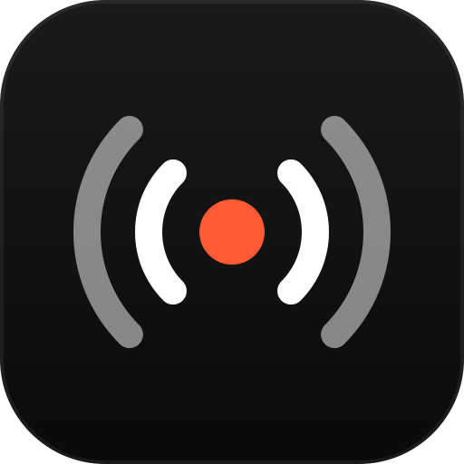
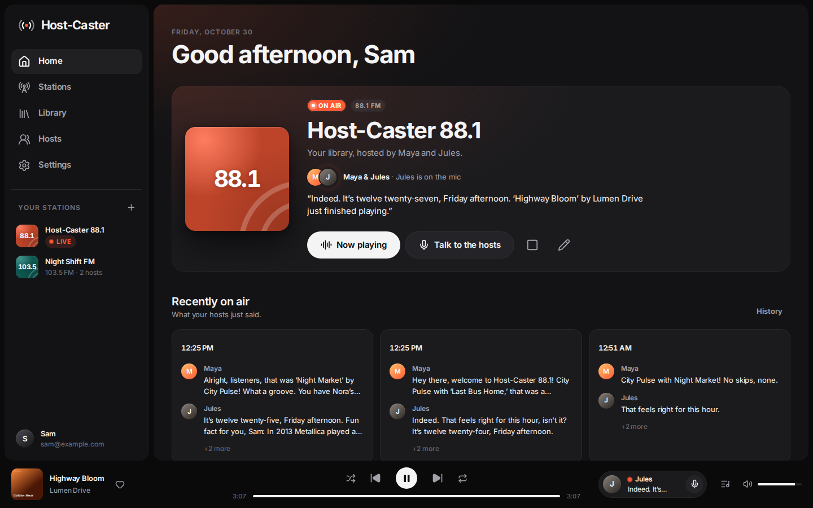
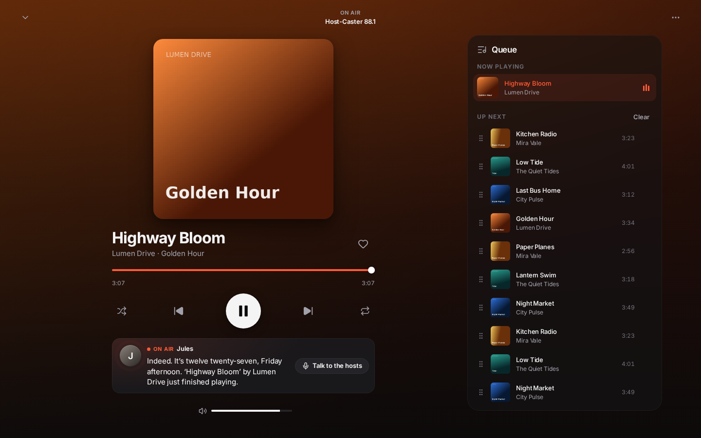
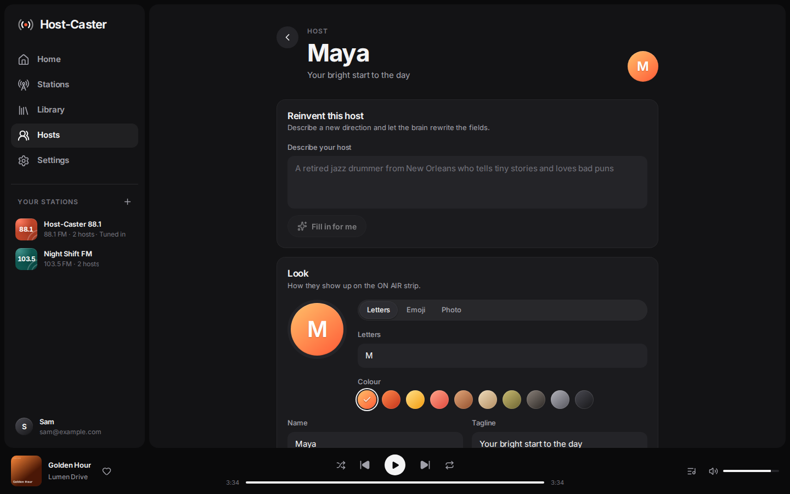
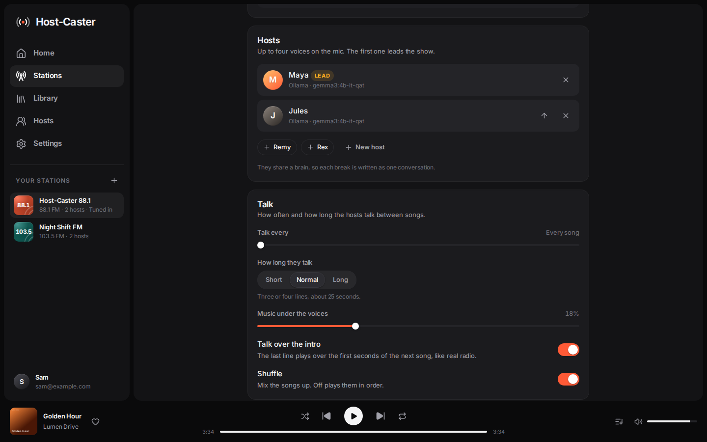
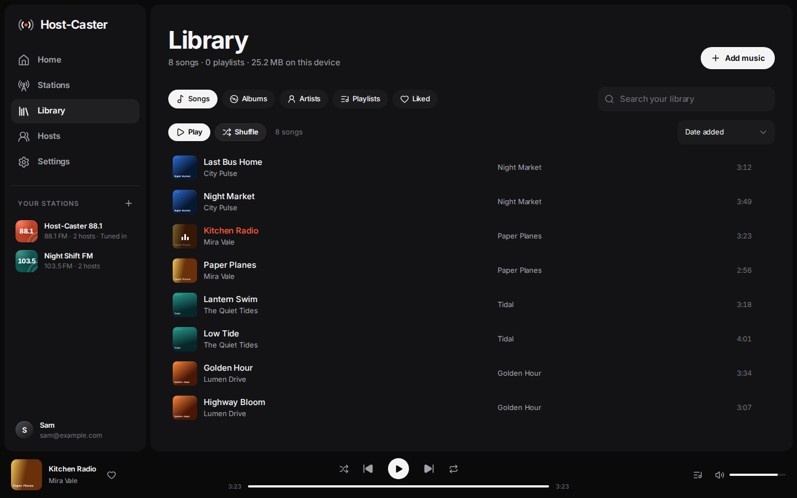
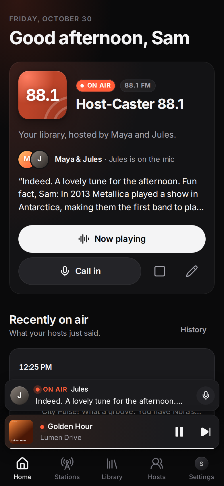

<p align="center"></p>

<h1 align="center">Host-Caster</h1>

<p align="center"><b>Your music. Your hosts. Your station.</b></p>

<p align="center">
  <a href="LICENSE">AGPL-3.0</a> ·
  <a href="docs/SELF-HOSTING.md">Self-hosting</a> ·
  <a href="docs/PROVIDERS.md">Brains, voices and music</a> ·
  <a href="https://host-caster.com">Hosted version</a>
</p>

Host-Caster turns your music into a personal radio station. Between songs, AI hosts you create break in like real
radio DJs: they talk about the song that just played, the weather outside, what is on your calendar, the news you
follow, a birthday coming up, and they banter with each other. You decide who they are (a calm late-night voice, a
cheeky morning duo), which AI they think with and how they sound. Bring music from your own files, your own music
server, internet radio, YouTube or Spotify, or keep using the music app you love on Android. It runs in the browser
and as an Android and iOS app, works offline with no account, and when you want sync, it runs on your own server.

This repository is the self-hosted edition: everything you need to run Host-Caster on your own computer or server.

**Do not want to run a server?** The hosted version at [host-caster.com](https://host-caster.com) is the same app with
accounts, sync and AI hosts and voices included in a plan, nothing to set up.

## Screenshots

| | |
| --- | --- |
|  |  |
|  |  |
|  |  |

Screenshots from a demo install with demo songs.

## Features

**Radio with hosts you design**
- Up to four hosts per station, each with a personality, speaking style, energy, humor, catchphrases, favourite
  topics and topics to avoid. Start from eight presets or describe a host in a sentence and let the AI fill it in.
- Breaks between songs with an ident chime and live captions; the music dips under the voice. Hosts can talk over
  the intro of the next song, like real radio.
- Two or more hosts hold a real conversation: one script from a shared brain, or turn by turn when each host has
  its own.
- Choose what hosts talk about per station: the songs, time of day, weather, your calendar, email, news, life
  events, notes, reminders, Notion pages and fun facts. Choose how often they talk (every 1 to 10 songs), for how
  long, and the **talk mix**: more about the music or more about your day.
- **Your day first**: every break carries one item from your day when there is one, and the first break of a session
  and of each hour is a short rundown (next events, reminders, weather, a headline or two).
- **Call in**: talk to the hosts by voice or by typing, and they answer on air.
- **On-air history** of every break, with the songs around it.
- Breaks are written while the song plays. If one is not ready in time, the music simply goes on: never silence.

**Brains and voices, your choice**
- Your ChatGPT plan: sign in with ChatGPT (paid plans such as Plus and Pro), no API key
  ([docs/CHATGPT-PLAN.md](docs/CHATGPT-PLAN.md)).
- Cloud AI with your own key: OpenAI, Anthropic Claude, xAI Grok, Google Gemini, Meta Llama API, OpenRouter, Groq,
  Mistral, DeepSeek, Together AI, Fireworks.
- Local AI on your own computer: Ollama, LM Studio, llama.cpp, vLLM, Jan, or any OpenAI-compatible server.
- Voices: your device's own voices (offline), OpenAI (with a speaking style per host), ElevenLabs (your cloned
  voices too), and local engines such as Kokoro, Chatterbox, Qwen3-TTS and Orpheus.
- Until an AI is connected, or when it is offline, too slow or at a limit, the hosts read short scripted lines (song,
  time, weather, your day) so the music never goes quiet.

**Your music, wherever it lives** ([docs/MUSIC-SOURCES.md](docs/MUSIC-SOURCES.md))
- Your files: songs and whole folders (MP3, M4A, FLAC, OGG, OPUS, WAV and more) with tags and covers. Playlists,
  likes, M3U and PLS import and export.
- Your server's music folder, streamed to every device.
- Subsonic and Navidrome servers.
- Tens of thousands of internet radio stations (radio-browser.info), or any stream address.
- YouTube playlists, Liked videos and search with your own Google sign-in setup ([docs/YOUTUBE.md](docs/YOUTUBE.md)),
  played in YouTube's own player.
- Spotify playlists and Liked Songs (Premium): plays in a desktop browser, or remote-controls your Spotify app.
- **Any music app mode** on Android: keep listening in YouTube Music, Apple Music or anything else, and your hosts
  break in between its songs.

**Your day, on air**
- Weather (Open-Meteo, no key), Google Calendar or any calendar link (ICS), Gmail or any IMAP mailbox (through your
  server), RSS news (public feeds for your region by default, or your own), life events, notes and reminders. Every
  source keeps its last snapshot, so the radio keeps working offline.
- **Notion**: one-tap sign-in through your server's own Notion connection. Hosts read the pages you pick and, only
  when you ask on a call or from your AI app, add a to-do or note to a Host-Caster page and say so on air (activity
  log with Undo, never touching what you wrote). Setup in [docs/SELF-HOSTING.md](docs/SELF-HOSTING.md).
- **What your hosts can see**: a settings page that shows every source as the hosts get it, and the next break.
- **AI apps**: connect ChatGPT, Claude and other assistants (MCP), and they can pass notes, segments, song requests
  and birthdays to your hosts.

**A real player**
- Crossfade, shuffle, repeat, queue, keyboard shortcuts, lock screen and notification controls, background play
  on Android and iOS, dark and light themes.
- Installable web app (PWA), Android app and iOS app from one codebase.

**Yours**
- No account needed. Sign in on your own server (Google, X, or email and password) to sync hosts, stations,
  brains, voices and playlists between your devices. Keys are stored encrypted on your server. Export a backup file
  any time.

## Quick start

### Docker (recommended)

You need Docker with the Compose plugin.

```sh
git clone <this repository> host-caster && cd host-caster
cp .env.example .env            # optional: PUBLIC_URL, Google or X sign-in, a music folder
docker compose up -d --build
```

Open [http://localhost:8660](http://localhost:8660). That is all you need to try it. To reach it from other devices,
add HTTPS, sign-in and your music folder: [docs/SELF-HOSTING.md](docs/SELF-HOSTING.md).

Check that it runs: `curl http://localhost:8660/api/health`.

### Without Docker

You need Node.js 24 or newer.

```sh
cd app && npm ci && npm run build && cd ..
cd server && npm ci --omit=dev
cp ../.env.example ../.env      # optional
npm start                       # http://localhost:8660
```

The server serves the web app, the API, sign-in and the AI apps connector on one port. Its data (one SQLite file and
an encryption key) lives in `DATA_DIR` (`server/data` by default). Every setting is in [.env.example](.env.example).

### First steps in the app

1. Open the app. A short welcome asks what to call you, lets you pick your hosts, where your music is and how the
   hosts should think: a model on your network, a cloud AI with your own key, or your ChatGPT plan (or **Set up
   later**).
2. **Library, Add music**: add some songs, or connect a music service in **Settings, Music services**.
3. **Home**: press **Go on air**. Until an AI is connected, the hosts read short scripted lines with your device's
   voice and Home says so, with a **Connect** button.
4. Connect an AI and a voice in **Settings, Brains** and **Settings, Voices**, or pick them on each host's page.
   [docs/PROVIDERS.md](docs/PROVIDERS.md) walks through every option, including free local ones.

## Phone apps

The Android and iOS apps are Capacitor shells around the same web app, with a native audio plugin for background play,
lock screen controls, ducking other apps and Any music app mode. They work alone, or with your server
(**Settings, Account, Your Host-Caster server**).

**Android**: each release on this repository has an APK built by GitHub Actions. To build it yourself you need JDK 21
and the Android SDK (platform 36):

```sh
cd app
npm ci && npm run build
npx cap sync android
cd android && ./gradlew assembleDebug
adb install -r app/build/outputs/apk/debug/app-debug.apk
```

Set `VITE_HOSTCASTER_SERVER=https://your.server` when you build to make your server the app's default. For a release
build, create your own signing key; keystores are never committed (see `app/android/app/build.gradle`).

**iOS**: you need a Mac with Xcode 26 or newer.

```sh
cd app
npm ci && npm run build
npx cap sync ios
npx cap open ios                # opens Xcode
```

Pick your team under **Signing and Capabilities**, choose a device or simulator, and press Run. Any music app mode is
Android only (iOS does not allow it).

App id `com.hostcaster.app`, link scheme `hostcaster://`. If you publish your own build, change the app id in
`app/capacitor.config.ts` and the native projects, and use your own name and icon ([TRADEMARKS.md](TRADEMARKS.md)).

## Desktop app

Windows, Mac and Linux: the same web app in an Electron window (`desktop/`), for your server or the hosted service,
plus your ChatGPT plan as the hosts' brain (off until you turn it on) and AI and voices at plain `http://` addresses on
your computer or network. Each release on this repository has the Windows installer and portable zip, a universal
macOS dmg and a Linux AppImage and .deb, built and smoke-tested by GitHub Actions (`.github/workflows/desktop.yml`).
They are not code-signed yet: Windows shows "Windows protected your PC" (More info, Run anyway) and macOS asks once in
System Settings, Privacy & Security (Open Anyway). [docs/DESKTOP.md](docs/DESKTOP.md) has the install steps, the
ChatGPT plan terms, the security model and how to build it:

```sh
cd app && npm ci && cd ../desktop && npm ci
scripts/build-app.sh && npm start      # run it (HOSTCASTER_SERVER=https://your.server for your own server)
npm run dist:linux                     # AppImage + .deb; dist:win on Windows, dist:mac on a Mac
```

## Documentation

- [docs/SELF-HOSTING.md](docs/SELF-HOSTING.md): run your own server, HTTPS, Google and X sign-in, phone apps, music
  library, AI apps, backups, updates.
- [docs/PROVIDERS.md](docs/PROVIDERS.md): every AI brain, voice and music source, with setup steps.
- [docs/YOUTUBE.md](docs/YOUTUBE.md): YouTube with your own Google OAuth client.
- [docs/CHATGPT-PLAN.md](docs/CHATGPT-PLAN.md): your ChatGPT plan as the hosts' brain.
- [docs/DESKTOP.md](docs/DESKTOP.md): the Windows, Mac and Linux app: install, first open, updates, building it.
- [docs/MUSIC-SOURCES.md](docs/MUSIC-SOURCES.md): what each music source needs on your server.
- [docs/PRIVACY.md](docs/PRIVACY.md): what is stored where and who sees what.
- [ARCHITECTURE.md](ARCHITECTURE.md): how the code fits together.

## Development

```sh
cd server && npm ci && npm run dev    # API on http://localhost:8660 (restarts on changes)
cd app && npm ci && npm run dev       # app on http://localhost:5173, proxies /api, /auth and /mcp to :8660
```

Tests:

```sh
cd app && npm run typecheck && npm test     # vitest: player, radio, AI, voices, library, services, sync
cd server && npm test                       # node:test: auth, sync, secrets, proxies, egress guard, MCP, library
```

End-to-end checks in `app/e2e/` drive a real browser (Playwright) against a built app and a running server; each
script's first lines list its arguments. CI runs the typecheck, both test suites and the web build, and builds an
Android APK and an iOS simulator app.

## Support

- Questions and ideas: GitHub Discussions on this repository.
- Bugs: open an issue (the template asks for what helps).
- Security problems: please do not open an issue; see [SECURITY.md](SECURITY.md).
- Anything else: [support@host-caster.com](mailto:support@host-caster.com).

## Contributing

Contributions are welcome. Read [CONTRIBUTING.md](CONTRIBUTING.md) first: pull requests are accepted under a short
contributor license agreement (you keep your copyright). Please follow the [Code of Conduct](CODE_OF_CONDUCT.md).

## License

Copyright (C) 2026 the Host-Caster project owner and contributors.

Host-Caster is free software under the [GNU Affero General Public License v3.0](LICENSE). You may use, study, change
and share it. If you run a changed version for other people over a network, you must offer them its source code too.

The Host-Caster name and logo are not covered by this license: see [TRADEMARKS.md](TRADEMARKS.md). Music, voices and
AI models you connect come with their own terms.
